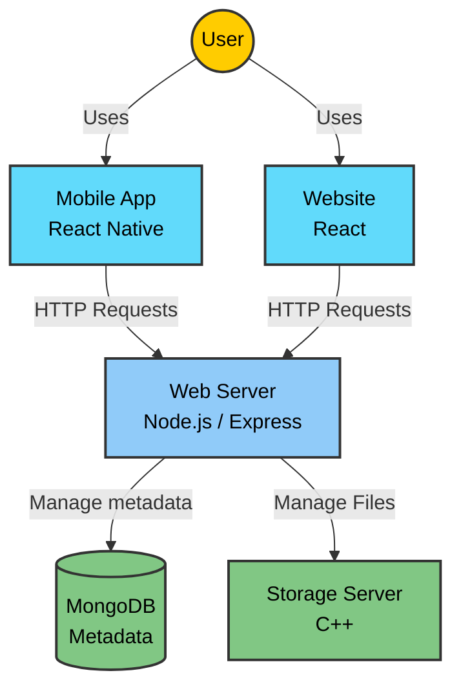

# ☁️ Cloud Storage System

<div align="center">


</div>

A full-stack cloud storage solution mimicking Google Drive's core functionality. Built with a **C++ Storage Server**, **Node.js API**, **React Website**, and **React Native Mobile App**.

> **Disclaimer:** This project is strictly a personal, educational project. It is not affiliated with, endorsed by, sponsored by, or in any way associated with Google or Google Drive. All trademarks belong to their respective owners.

---

## 📚 Documentation

Everything you need is in our detailed guides:  
👉 [Full documentation](./wiki/README.md)

| Guide | Description |
|-------|-------------|
| 🚀 [Running Instructions](./wiki/README.md#-running-instructions) | Quick setup with Docker |
| 🖥️ [Website Guide](./wiki/documentation/website.md) | Complete website guide |
| 📱 [Mobile Guide](./wiki/documentation/mobile.md) | Complete mobile app guide |
| 🛠️ [API Reference](./wiki/documentation/API.md) | Backend API documentation |

---

## 🏗️ Architecture



**Components:**
- 🗄️ **C++ Storage Server** - Multithreaded file storage
- 🌐 **Node.js API** - Express backend with JWT authentication
- 💾 **MongoDB** - User and metadata storage
- ⚛️ **React Website** - Interactive web interface
- 📱 **React Native App** - Cross-platform mobile app

---

## ✨ Features

- **📂 File Management** - Upload, view and edit files.
- **📂 Folder Management** - Create and upload folders to handle many files.
- **🔐 JWT Authentication** - Users must prove their identity to access files
- **🤝 File Sharing** - Share files and folders with other users
- **⭐ Starred & Trash** - Star important files, restore deleted from trash
- **🔍 Search** - Search text in filename or content
- **📱 Web + Mobile** - Works on browsers and phones (Android/iOS)
- **🌗 Dark Mode** - Easy on the eyes at night

---

## 🚀 Quick Start

### What You Need
- **Docker Desktop** (must be running)
- **Git**
- **For mobile:** Expo Go app on your phone ([get it here](https://expo.dev/client)) or an emulator

### Step 1: Clone & Start Backend

```bash
git clone https://github.com/username-YG/Google-Drive-Clone
cd Google-Drive-Clone

# Start all backend services + website
docker-compose up --build mongodb storage-server web-server react-app
```

**Website will be at:** [http://localhost:5173/](http://localhost:5173/)

### Step 2: Run Mobile App

**Using Android Emulator:**
```bash
# Start the app
HOST_IP=10.0.2.2 docker-compose run --service-ports --rm mobile-app
```
Then in your emulator: Open Expo Go → Manual entry → Type `exp://10.0.2.2:8081`

**Using Your Phone:**

First, find your computer's local IP:
```bash
# On Windows
ipconfig

# Look for "IPv4 Address" (usually starts with 192.168 or 10.)
```

Then run:
```bash
HOST_IP=192.168.X.X docker-compose run --service-ports --rm mobile-app
```
*(Replace `192.168.X.X` with your actual IP)*

Scan the QR code with Expo Go and you're in!

> **Note:** Your phone and computer must be on the same WiFi network

---

## 📸 Screenshots

### Web Interface - File Management


### File Preview & Sharing


### Mobile App


