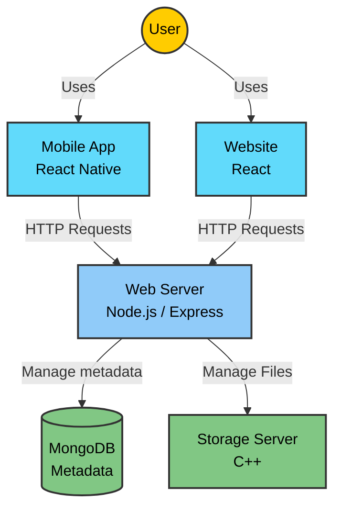

# Google Drive System

## 📑 Table of Contents

1. **[System Overview](#-overview)**
2. **[Requirements](#-requirements)**
4. **[Running instructions](#-running-instructions)**
5. **Website guide**
    - **[Registration and Authentication](#5-registration-and-authentication)**
    - **[Upload and View Files](#6-upload-and-view-files)**
    - **[Files Operations](#7-files-operations)**
6. **Mobile guide**
    - **[Registration and Authentication](#registration-and-authentication)**
    - **[Upload and view files](#upload-and-view-files)**
    - **[Files operations](#files-operations)**

## 📚 Detailed Documentation

- **[Website documentation](./documentation/website.md)**
- **[Mobile app documentation](./documentation/mobile.md)**
- **[API documentation](./documentation/API.md)**

---
## 🧐 System Overview
<a id="-overview"></a>
### 🧩 Main components
The google drive system consists of the following components:
 1.  **Storage server:** Multithreaded C++ server to store files.
 2.  **MongoDB:** Database for storing users and files metadata.
 3.  **Web Server:** Node.js (Express) API.
 4.  **Website:** React interactive frontend for users.
 5.  **Mobile app:** React Native (Expo) mobile app for Android/iOS.

### 🛠️ Architecture Diagram


### 🔥 Features

#### 📁 File Management
- [x] **Upload Files:** Users can upload files to store in the storage server.
- [x] **View & Download Files:** Users can view uploaded files and download them.
- [x] **File Management:** Files can be edited, renamed, stared, trashed and more.
- [X] **Files Sharing:** Users can share they files and folders with other users.
- [X] **Folder Management:** Users can create and upload folders to handle many files.

#### 🔐 User Registration & Authentication
- [x] **Authentication:** Secure user registration and login using JWT (JSON Web Tokens).
- [x] **Personal Storage:** Each user has their own private storage.
- [x] **Permission Control:** Users control file access and sharing permissions.

#### 📱 Cross-Platform Support
- [x] **Web:** Interactive UI design for web users.
- [x] **Mobile App:** Interactive mobile app for Android/iOs Users.
- [x] **CLI:** Can interact with the storage server directly from the command line.

## ✅ Requirements
<a id="-requirements"></a>
Before we start, make sure you have the following 

- **Git**
- **Docker**
- **Docker Compose**
- **Web browser**
- **Expo Go**
  - Install "Expo Go" on your physical phone.
  - OR set up an Emulator.
  - See [Expo setup guide](https://docs.expo.dev/get-started/set-up-your-environment/).

## 🚦 Running instructions
<a id="-running-instructions"></a>
### 💻 Step 1: Setup
Ensure Docker Desktop is running.
Clone the repository and enter the folder:
```bash
git clone https://github.com/username-YG/Google-Drive-Project-ASP
cd Google-Drive-Project-ASP
```
### 🌐 Step 2: Backend and website
Start the web server, storage server, mongo and website:
```bash
docker-compose up --build mongodb storage-server web-server react-app
```
Enter the website at [http://localhost:5173/](http://localhost:5173/).  
<details>
  <summary><strong>👇 You can also run each service separately</strong></summary>

  <br>

You can also run each service separately
  - **Start MongoDB:**
```bash
docker-compose up --build mongodb
```
  - **Start the storage server:**
```bash
docker-compose up --build storage-server
```
  - **Start the web server:**
```bash
docker-compose up --build web-server
```
  - **Start the website:**
```bash
docker-compose up --build react-app
```

<br>

</details>

### 📱 Step 3: Mobile app (Option A - Emulator)
```bash
HOST_IP=10.0.2.2 docker-compose run --service-ports --rm mobile-app
```
Start the emulator, Install Expo Go and insert the URL "exp://10.0.2.2:8081".  

     
<br>

### 📱 Step 3: Mobile app (Option B - physical device)
Your phone and computer must be on the same local network.
Find your computer's IP by running:
```bash
# If on Ethernet:
powershell.exe -Command "(Get-NetIPAddress -AddressFamily IPv4 -InterfaceAlias 'Ethernet').IPAddress"

# If on Wi-Fi:
powershell.exe -Command "(Get-NetIPAddress -AddressFamily IPv4 -InterfaceAlias 'Wi-Fi').IPAddress"

# Manually check:
ipconfig.exe
```
Run the mobile app (replace [YOUR_IP] with the address you found above)
```bash
HOST_IP=[YOUR_IP] docker-compose run --service-ports --rm --build mobile-app
```
Open Expo Go on your phone, scan the QR and enjoy!

---

## Website guide
The website is a smart web application designed to emulate the core functionality and user experience of Google Drive. It is built as a modern Single Page Application that seamlessly integrates an interactive user interface with a dynamic backend server for real-time data management.
We'll show here the main functionality and a more expanded explanation can be found at - **[Website documentation](./documentation/website.md)**

To run the website, follow the guide from the Running Instructions above.
Then, the website works like that:

### Registration and Authentication
The Web interface provides a secure and seamless onboarding process.
- Multi-step Registration: Users can create an account by providing a display name, username (the mail address), password, and a profile picture upload.


- Secure Authentication: Powered by JWT (JSON Web Tokens). Once logged in, the token is stored securely to maintain the session across refreshes.
- Validation: Real-time feedback for password strength and username availability.


### Upload and View Files
Efficient file management is at the core of the Google Drive project.
- Universal Upload: Supports various file types (Images, Text and PDF). Files are transmitted from the React frontend to the Node.js server, which then streams them to the C++ Storage Server.


- Grid & List Views: Organized layout showing file icons based on their type (e.g., custom icons for .pdf, .txt, and folders).


- Real-time Preview: Integrated file viewers allow users to view images and read document contents directly in the browser without downloading.


### File Operations
A rich set of features to manage your data, mimicking the full Google Drive experience:
- Search & Filter: A powerful search engine (implemented via a dedicated Search Controller) that finds files instantly by name or type.


File Organization: Create folders, move items between directories, and rename files on the fly.


Sharing System: Collaborate by sharing files with other registered users. Shared items appear instantly in the "Shared with me" section.


Trash Management: Integrated safety net – files can be moved to the Trash and either restored or permanently deleted from the C++ storage.


## Mobile-App guide
### Registration and Authentication
The mobile application offers a native, step-by-step onboarding experience designed for small screens.

- Guided Registration: A clean, sequential flow that guides users through entering their username, password, display name, and selecting a profile picture from their gallery.


- Native Authentication: Secure login persistence using local storage, ensuring users stay logged in between app sessions.


### Upload and View Files 
Optimized for on-the-go productivity, the mobile app provides full access to the cloud storage.


- Mobile File Picker: Integrated with the device's native file system, allowing users to upload documents, images, and other media directly from their phone.


- Custom File Viewers: High-performance preview components for various formats (Images and Text) integrated directly into the app using a dedicated file Viewer.


Visual Navigation: A tab-based navigation system (Home, Starred, Shared, Files) with custom icons that clearly distinguish between different file categories.


### Mobile File Operations
The app delivers a full suite of management tools via a mobile-optimized UI:

- Native Context Menus: Long-press or tap the "three dots" icon to trigger an ActionMenu, providing access to Rename, Share, Move, and Delete operations.


- Shared Workspace: Real-time access to the "Shared with Me" section, allowing users to collaborate on documents while mobile.

- Efficient Organization: Users can create new folders or move files between directories using a specialized window built for touch interfaces.


- Search Integration: A dedicated search tab with real-time filtering, making it easy to locate specific files within a large cloud directory.


#### Special Note - Dark Mode
Both website and app are supporting dark mode theme for the entire system(!):

click the settings button and then choose the toggle:


And now everything will be in dark mode!


And Also for the Mobile app:


### Enjoy our system!
